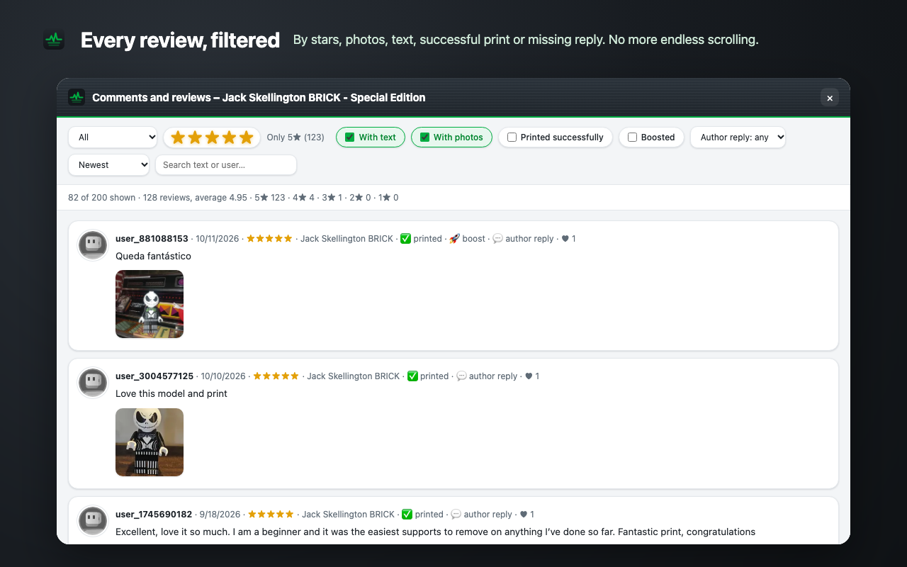
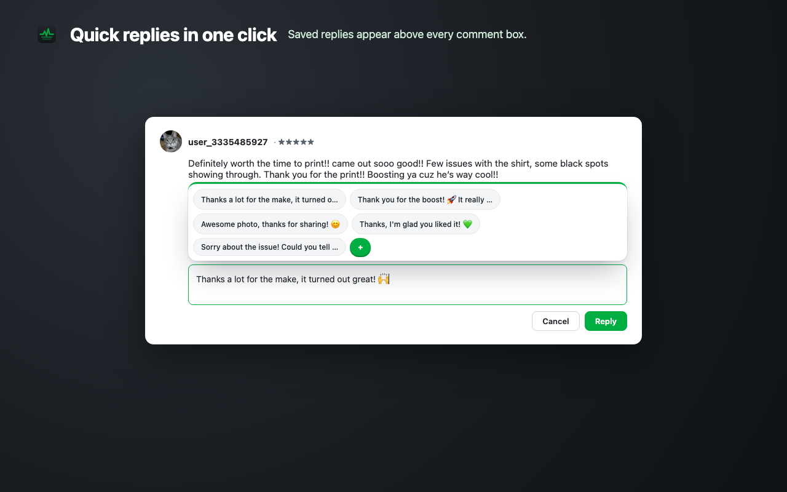
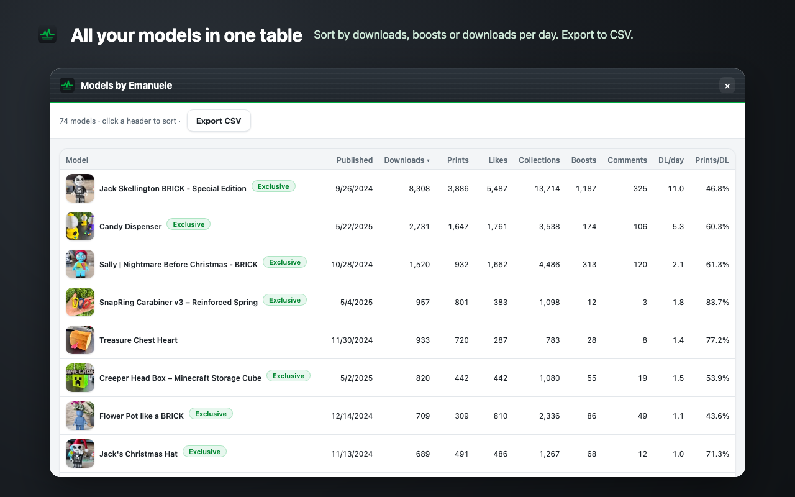

<h1 align="center">MakerPulse</h1>

Stats, points, gift cards, review filters and quick replies for <a href="https://makerworld.com">MakerWorld</a> creators.

  
  

  
  
  
  

  
  
  
  
  

  
  
  

---

## Features

- **Model page** – downloads, prints, likes, collections, boosts, comments, print/download and like/download ratios, downloads per day, per-profile breakdown (downloads, prints, rating, print time). On your own models: points earned (total, last 30 and 7 days, from boosts) and their gift card value.
- **Points & gift cards** – total, exclusive and regular points, points earned in the last 7 and 30 days, how many gift cards you can redeem per region and how many points to the next one, cash redemption amount, top-earning models.
- **Reviews & comments** – loads every comment and filters by stars, text, photos, successful print, boost, or unanswered; search and sorting. Click a result to jump to it on the page.
- **To reply** – every review and comment you haven't answered yet, across all your models, in one list (filter by period, text, photos).
- **Trends** – daily snapshots of your models saved in your browser: downloads per day, points per day, which models are growing or slowing down.
- **Forecasts & boosters** – the date you'll reach the next gift card or the cash minimum at your current pace, and who boosted you in the last 30 days.
- **Model cards** – prints, boosts, print rate and hot score shown on every model card on home, search and profile pages.
- **Models table** – every model of a creator in a sortable table with totals and CSV export (with points per model on your own profile).
- **Quick replies** – your saved replies appear above any comment or reply box, in the language of the person you're replying to (Italian or English); hover to read the full text, click to insert. Edit them in the popup or save what you just typed with `+`.
- Works with every MakerWorld language and with in-site navigation (no reload needed). English and Italian interface.

## Install

### Chrome Web Store
Coming soon.

### Manual install (Chrome, Edge, Brave, Vivaldi)
1. [Download the ZIP](https://github.com/emanueletech/makerpulse/releases/latest/download/makerpulse.zip) from the latest release and unzip it.
2. Open `chrome://extensions` (or `edge://extensions`) and enable **Developer mode**.
3. Click **Load unpacked** and select the unzipped folder.
4. Open any model or profile page on makerworld.com.

Manual installs don't update automatically: download the new release and replace the folder.

## Privacy

MakerPulse collects no data. It only talks to makerworld.com using your existing session, and stores settings and a points summary locally in your browser. See the [privacy policy](https://emanueletech.github.io/makerpulse/privacy-policy.html).

## Disclaimer

MakerPulse is an independent project and is not affiliated with Bambu Lab or MakerWorld.

---

## Italiano

Estensione per i creator di MakerWorld: statistiche dei modelli, punti e gift card, filtro di commenti e recensioni, tabella dei modelli con export CSV e risposte rapide ai commenti. Interfaccia in italiano se il browser è in italiano.

**Installazione manuale:** [scarica lo zip](https://github.com/emanueletech/makerpulse/releases/latest/download/makerpulse.zip), decomprimilo, apri `chrome://extensions`, attiva la **Modalità sviluppatore** e scegli **Carica estensione non pacchettizzata**.
